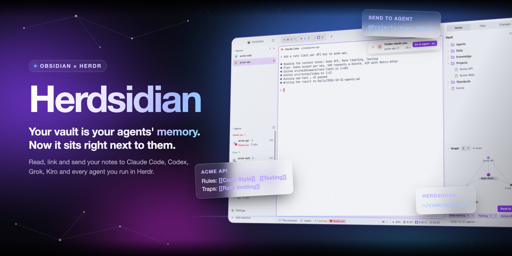
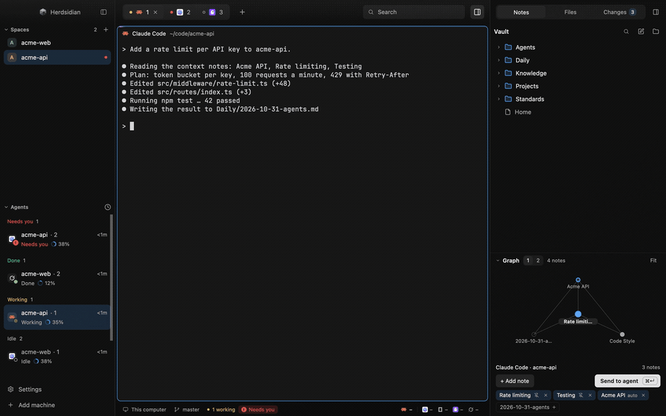
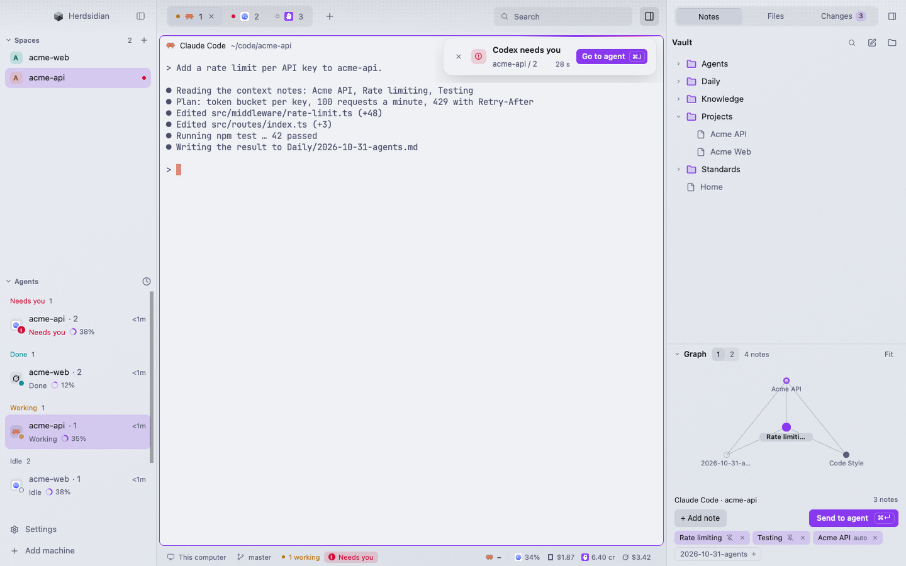
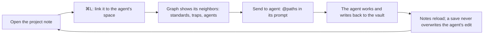
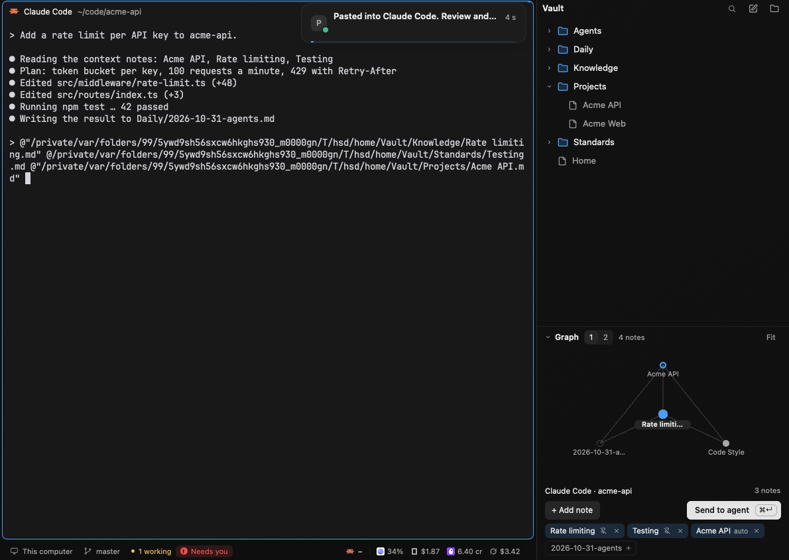
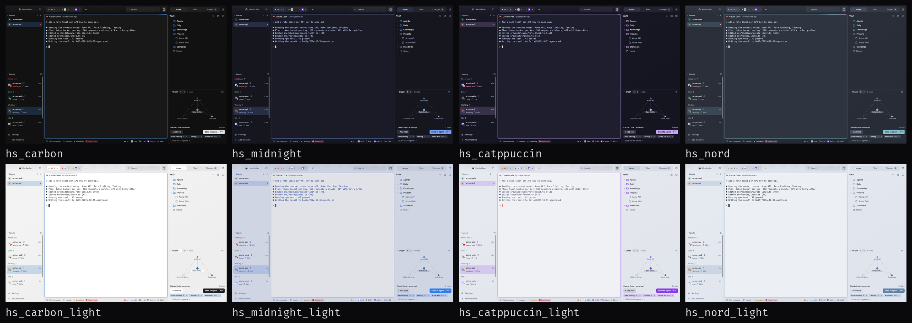

<p align="center">
  
</p>

<p align="center"><i>‹ your vault, next to your agents ›</i></p>

<p align="center">
  <a href="https://herdr.dev"></a>
  
  
  
  
  
  
  
  <a href="LICENSE"></a>
</p>

<p align="center">
  
</p>

<p align="center"><sub>20-second cut, demo data. <a href="docs/film.mp4">Full film (MP4, 82 s)</a></sub></p>

---

**Your Obsidian vault is your agents' memory. Herdsidian puts it next to them.**

A [Herdr](https://herdr.dev) layout for people who run their coding agents from an
Obsidian vault: agent briefs, standards, project notes and daily logs in Markdown, read by
the agents and written back by them. Herdsidian opens that vault in a **Notes** sidebar
beside your terminals. You read and edit notes, and create, rename and delete notes and
folders, while the agents work. You link the right notes to each space and hand them to an
agent with one click.

It works with the agents Herdr runs: **Claude Code, Codex, Grok, Kiro and opencode**. The
status bar shows their usage, each Claude Code, Codex, Kiro and Grok agent row shows how full
its context window is, and an agent that needs you shows a card at the top right.



---

## Who it's for

- Your agent setup lives in a vault: `CLAUDE.md`-style briefs, agent definitions,
  standards, one note per project, a daily log the agents append to.
- You take notes all day, while the agents work, and want them one key away, not one
  app away.
- You want the agent to start from the right notes, and the notes to keep up with what the
  agents learn.

---

## The loop



1. **Open the note.** Browse the vault or find a note by name. `[[Wikilinks]]` (with
   `|alias` and `#heading`) open the linked note.
2. **Link it to the space.** `⌘L` links the open note to the focused agent's space.
   Linked notes stay in a strip, per space, across restarts. A note's pin switches it
   between "Whole space" and "This agent only".
3. **See what it touches.** The local graph shows the note's neighbors at 1 or 2 hops:
   the standards it cites, the traps it warns about, the agents that use it.
4. **Send it.** **Send to agent** pastes the linked paths into the agent's prompt:
   `@path` for Claude Code, the plain path for other agents. It never presses Enter.
5. **Let it write back.** When an agent (or Obsidian, or git) changes a note you have
   open, your save asks first: Reload or Overwrite.



**Link notes to a folder once, in the note itself.** A `herdsidian:` key in the
frontmatter links the note whenever an agent works in that folder or below it:

```yaml
---
herdsidian: ~/code/acme-api
---
# Acme API
```

---

## Features

- **One right sidebar, three tabs.** **Notes · Files · Changes**, 380 px, so the
  terminal keeps its room. `⇧⌘E` opens Files, `⇧⌘G` Changes and `⇧⌘O` Notes. The key of the
  tab already shown hides the sidebar. Each tab's tooltip shows its key. The tab you chose is remembered. It collapses to a 44 px rail with one icon per tab.
- **Notes tab.** Folders, notes and search. Read mode renders
  frontmatter, headings and links; `⌘E` switches to Edit and `⌘S` saves. A button copies the
  note's full path. Any folder of Markdown files works; Obsidian is not needed.
- **Files and Changes tabs.** Files browses and previews the files of the focused pane's
  folder. The preview wraps long lines and colors code, web files included. Changes lists
  the changed files of its repo (from `git status` and `git diff --numstat`) with +N / −N,
  and a count badge on the tab; a click opens the file in Files.
- **Toolbar sidebar toggle.** One icon button right of Search shows or hides the right
  sidebar. It is lit while the sidebar is shown. It is the only sidebar control in the toolbar; its tooltip shows no key.
- **Usage in the status bar.** The limits of your agent CLIs sit at the right of the status
  bar: the provider of the focused pane in full, the others compact. Hover opens the usage
  card. Kiro and Grok show this month's use (Grok needs the status-line script, see below).
  An off switch in Settings (**Usage in the status bar**) hides it and stops every fetch.
- **Settings in `⌘K`.** **Theme**: four family rows (Carbon, Midnight, Catppuccin, Nord) that set
  the dark and the light half together; one appearance row opens Herdr Settings → Look,
  because a mod cannot set light or dark. **Key hints**: Always / On hover / Off. **Layout**:
  right sidebar, its tab, sidebar width, Usage in the status bar, Context in the sidebar.
- **Next blocked agent.** `⌘J` focuses the next agent that needs you, after the focused one,
  and wraps. The status bar pill shows `⌘J` and does the same on click.
- **Right-click menu.** Create, rename and delete notes and folders from the tree. Delete
  moves the item to the Trash. Rename updates the links to it in your other notes.
- **Agent context.** Notes linked per space, with extras for one agent. Suggestions (the
  space's repo name, recent notes, alias or tag matches) show faded; one click pins them.
- **Local graph.** The open note (or the first linked note) at 1 or 2 hops, up to 40
  nodes. Drag to pan, scroll to zoom, click to open. It folds while you read a note and
  comes back when you return to the tree; hide it yourself if you don't need it.
- **Send to agent.** The main button of the context strip, with a `⌘↵` key cap. `+ Add note`
  sits at its left; "Add current note" (`⌘L`) is in its picker.
- **⌘K palette.** One search for notes, agents and commands, in a popup at the top.
  Tabs: All, Notes, Agents, Commands, Settings. `↵` opens a note, focuses an agent or runs a
  command. `⌘↵` pastes the selected note's path into the agent you were working with.
  It never presses Enter. `⇥` previews the note.
- **Shortcut guide.** Each space shows `⌃1…⌃9` and each agent `⌥⌘1…⌥⌘9`, so you
  jump between agents without the mouse.
- **Graphite glass look.** Tinted glass over a gradient of the theme, terminals as solid
  cards. Eight themes, every color derived from the theme:
  `hs_carbon` (default), `hs_midnight` (Tokyo Night), `hs_catppuccin` (Mocha),
  `hs_nord`, and a light version of each. The 52 px header bands carry a fine dot texture,
  and the sidebar header shows the Herdsidian icon.
- **Quiet Spaces.** Each space is an avatar, its name and a few signals: ahead/behind pills,
  a dot when blocked, and the `⌃N` key on the first nine rows. The branch is in the row's
  tooltip.
- **One "Needs you" signal.** A blocked agent shows the same pill with a "!" mark in the
  agents list, the pane header, the status bar and the palette. The status bar pill
  (with the count when more than one) jumps to the blocked agent.
- **Working bar.** While an agent works, a thin moving bar runs along the top of its pane.
- **Agent cards.** Herdr's notices show as agent cards at the top right, beside the right
  sidebar. A "Needs you" card stays until you act: the X at its far left closes it and
  **Go to agent** focuses the agent. A "finished" card fades out on a timer. Up to three
  show, then "+N more".
- **Context ring.** Each Claude Code, Codex, Kiro and Grok agent row shows how full its
  context window is, as a ring in the accent color that turns to the alert color at 90 %.
  **Context in the sidebar** in Settings turns it off.



---

## Install

Ask your agent, from a Herdr terminal:

> Read ~/.config/herdr-app/AGENTS.md, then add this layout: herdr.dev/layouts/anderssonq/herdsidian

Or clone it and ask the agent to add it from the clone:

```sh
git clone https://github.com/anderssonq/herdsidian.git herdsidian
```

> Read ~/.config/herdr-app/AGENTS.md, then add the Herdr layout in ./herdsidian.

Then press `⇧⌘O` and **Choose a vault**.

<details>
<summary>By hand</summary>

1. Copy `layouts/herdsidian.json` and `layouts/herdsidian.svg` (its picture in
   Settings → Look), the eight files in `themes/` and the eight folders in
   `mods/` into `~/.config/herdr-app/` (same paths). If you installed an earlier
   version, remove the old `themes/herdsidian_*.json` files.
2. Merge the `layout:herdsidian` and `mod:herdsidian` sections of `keys.json` into
   `~/.config/herdr-app/keys.json`.
3. Check the mods:
   ```sh
   cd ~/.config/herdr-app/mods
   for m in herdsidian herdsidian-chrome guide-spaces guide-agents herdsidian-tabs herdsidian-pane herdsidian-status herdsidian-toast; do herdr-app check $m; done
   ```
4. Switch to it: `herdr-app do layout.switch '{"name":"herdsidian"}'`, or Settings →
   Look, or Herdr's default `⌃⇧L`, which cycles layouts.

</details>

<details>
<summary>Only the Notes sidebar, in your own layout</summary>

Copy `mods/herdsidian/` and add this block as the last child of your layout's root row.
Herdr's own layouts are read-only, so clone one first:
`herdr-app do layout.clone '{"name":"main","as":"my-layout"}'`.

```json
{ "id": "herdsidian", "type": "block", "hidden": true, "size": { "px": 380 },
  "min": 44, "max": 720, "content": { "mod": "herdsidian" } }
```

Then bind a key in `keys.json`, for example
`"layout:my-layout": { "cmd-shift-o": "layout.toggle:herdsidian" }`, and add the
`mod:herdsidian` section.

</details>

---

## Keys

| Keys | What it does |
|---|---|
| `⇧⌘O` | Show the right sidebar on Notes; pressed on Notes, hide it |
| `⇧⌘E` / `⇧⌘G` | Show the right sidebar on Files / Changes; pressed on that tab, hide it |
| `⌘J` | Focus the next agent that needs you (wraps) |
| `⌘L` | Link the open note to the focused agent's space (no note open: open the picker) |
| `⌘K` | Open the Herdsidian palette (the toolbar's Search box does the same) |
| `↵` | In the palette: open the note, focus the agent or run the command |
| `⌘↵` | On a note's context strip: Send to agent. In the palette: paste the selected note's path into the agent that was focused when you pressed `⌘K` (no Enter) |
| `⇥` | In the palette: preview the selected note |
| `↑` / `↓` | In the palette: move the selection |
| `Esc` | Close the palette |
| `⌘E` / `⌘S` | In a note: switch Read and Edit / save |
| `⌘/` | Herdr's list of every shortcut (`app.help`) |
| `⌃1` … `⌃9` | Go to space 1–9 |
| `⌥⌘[` / `⌥⌘]` | Previous / next space |
| `⌥⌘1` … `⌥⌘9` | Go to agent 1–9 |
| `⌘[` / `⌘]` | Previous / next agent |

`⌘E` and `⌘S` live in the `mod:herdsidian` section and work only while the Notes panel
has the keyboard. The rest live in `layout:herdsidian`, so your keys in other layouts
don't change.

---

## The ⌘K palette

`⌘K` (or the toolbar's Search box) opens a popup at the top of the window, 680 px wide,
in the theme's opaque `popover` color. `⌘K` again closes it.

- **Tabs.** All, Notes, Agents, Commands. With text typed, All shows the best match as the
  Top hit (a note shows its folder, "linked to <space>" and when it was edited), then up
  to 4 agents, 6 notes and 4 commands. A single tab shows up to 50.
- **Settings.** The Settings tab changes Herdsidian's look in place (the palette stays
  open). Theme: four family rows (a pick keeps the palette open) and an Appearance row that
  closes the palette and opens Herdr Settings → Look. General: **Key hints**
  Always / On hover / Off. "On hover" shows the keys on the row under the pointer, because a
  mod cannot see modifier keys while a terminal has the keyboard. Layout: **Right sidebar**
  Shown / Hidden, **Right sidebar tab**, **Sidebar width** Expanded / Rail (while shown),
  **Usage in the status bar** On / Off and **Context in the sidebar** On / Off. The Right
  sidebar row shows no key. The values live in one store, `herdsidian.settings`, that every
  mod reads.
- **Search.** A note matches when its name contains the text; an exact name, then a
  prefix, then a word start rank first, and notes linked to the space win ties. Agents
  match on program, space, tab or title. Commands match on their label.
- **Empty search.** The agents, the space's linked notes and the commands.
- **Keys.** `↵` opens the note (Notes is shown if hidden, and expanded if it was a rail),
  focuses the agent or runs the command. A note of another vault is not opened: a toast
  says "Note is in another vault: <name>". `⌘↵` sends the note's path to the target agent: the agent that had focus when
  you pressed `⌘K`. Moving over another agent does not change it. `⌘↵` pastes only after
  the focus has reached the agent's terminal and never presses Enter. Otherwise it only
  copies and says "Copied. Press ⌘V in the agent." `⇥` shows the first 2 KB of the note.
  `↑` `↓` move, `Esc` closes. A key that does nothing for the selected row is faded in
  the footer, with its reason as a tooltip.
- **`⌥⌘N` hints.** An agent row shows its key only when it is the Nth agent of the agents
  list and that key is bound. Otherwise there is no hint.
- **Commands.** "Link note to current agent…" (`⌘L`), "New <agent> in <space>" (no key),
  "Show Notes" / "Hide Notes" (`⇧⌘O`), "Choose vault…" (only with no vault) and
  "All Herdr commands… `⇧⌘P`".
- **Link mode.** "Link note to current agent…" turns the palette into a note finder for
  the space. `↵` links the note, as `⌘L` does, and closes.
- **No vault.** Agents and commands still work. The palette says "Open Notes once (⇧⌘O)
  to choose a vault".
- **Missing vault.** If the vault folder is gone or cannot be listed, the Notes section
  shows the error instead of an empty list.

---

## What it isn't

- **Not an Obsidian replacement.** No tags view, no whole-vault graph, no image embeds
  (`![[image.png]]` shows its file name). Attachments cannot be renamed or deleted one by
  one: the tree shows only folders and notes.
- **Not a sync tool.** It reads and writes the files in place. Obsidian, git and your
  agents see the same files.
- **Not online.** Notes, links, the graph and Send stay on your machine. The only network
  call is the Claude Code usage card: one `GET` to Anthropic, on hover, at most every
  5 minutes. **Usage in the status bar** Off stops it.

---

## What it runs and stores

- `herdsidian` reads and writes only inside the vault you choose. It runs `find` and `sh`
  to list notes, `awk` to read their links, `git` to find an agent's repo folder, and
  `open` (macOS) or `xdg-open` (Linux) for web links.
- Context links live in `${XDG_STATE_HOME:-~/.local/state}/herdsidian/context.json`:
  machine-local, never in the vault. A file written by a newer Herdsidian is shown and
  never overwritten.
- **Send to agent** puts the paths on the clipboard and pastes them only after the focus
  has reached the agent's terminal ("Pasted into <agent>. Review and press Enter.");
  otherwise it only copies and says "Copied. Press ⌘V in the agent." It never presses
  Enter. At most 600 characters, the center note first;
  "+N not sent" counts the rest. The button shows "Sending…" while a send runs. It is off
  for remote spaces.
- **The palette** is a second copy of the `herdsidian` mod that Herdr opens as a popup. It
  lists notes with one `find` per open (up to 5,000) and reads the context file. It does
  not build the link index. `⌘↵` uses the same paste as **Send to agent**, with one path.
  The clipboard keeps that path. The two copies talk through these shared keys, each
  written only when its value changes: `herdsidian.vault`, `herdsidian.auto` (notes with a
  `herdsidian:` key, at most 200), `herdsidian.memory` (the remembered agent per space),
  `herdsidian.request` (open a note, choose a vault), `herdsidian.context-rev` (the
  palette changed the context file) and `guide-agents.order` (the first 9 agent
  addresses, for the `⌥⌘N` hints).
- `guide-spaces`, `guide-agents`, `herdsidian-chrome`, `herdsidian-tabs`, `herdsidian-pane`
  and `herdsidian-status` are restyled copies of Herdr's `spaces`, `agents`,
  `workspace-chrome`, `tabs`, `pane` and `workspace-status` (0.1.10), with the same
  behavior. `guide-spaces` runs `git` and `hc machine ls` like the original.
- `herdsidian-toast` draws every notification as an agent card at the top right, next to the
  right sidebar (the layout root sets `"toast": "herdsidian-toast"`). "Needs you", login and
  error cards stay until you act or until the agent is no longer blocked or the machine is ready
  or gone. Each card is one 60 px row: an X at the far left closes a card that stays, and
  **Go to agent** or **Copy** (the login command) sits at the right.
  Timed cards show a timer line, paused while the pointer is over the card and while Herdr is
  not the active window. Up to three cards show, then "+N more"; a new notice from the same
  agent or machine replaces its card in place.
- **Usage** (`herdsidian-status`, right of the status bar). Hovering it shows the limits of your agent CLIs.
  With **Usage in the status bar** off in Settings, nothing is shown and nothing runs.
  This mod runs programs, reads credentials and reaches the network, only on the first
  hover and then at most every 5 minutes per agent. It runs `/bin/sh` with `/usr/bin/security`,
  `/usr/bin/plutil`, `/usr/bin/curl`, `cat`, `find`, `stat`, `sort`, `head`, `grep`, `awk` and `tail`, and `opencode stats --days 7`.
  It reads Claude Code's login (the macOS Keychain item `Claude Code-credentials`, else
  `~/.claude/.credentials.json`) and the last lines of Codex's session logs in
  `~/.codex/sessions`. It sends one `GET` to `https://api.anthropic.com/api/oauth/usage` with
  that token. The token is never in a command line, stored, logged or shown: it goes from the
  Keychain to `curl` inside one shell pipeline, and the mod never refreshes or writes it.
  Kiro and Grok add no network host, no credential read, no `kiro` CLI and no write. For Kiro the mod
  runs one read-only `/bin/sh` with `find`, `stat`, `grep` and `awk`. It lists `sessions/cli/*.json` under
  `$KIRO_HOME` (when it is an absolute path that is not `/`, not your home and not a parent of it;
  otherwise `~/.kiro`), the older format, and reads those session files (folder, timestamps and
  credit counts); the title in them is never kept. A file of 1 MiB or more is never read: the card
  counts it as skipped ("1 file skipped"). The same script also finds the
  `sessions/<workspace hash or _global>/sess_<id>/messages.jsonl` files changed this month (newest
  first, at most 400) and greps their `usage_summary` lines. It prints only three fields: the line's
  timestamp, and each entry's unit and usage. Prompts, message bodies, tool names, and turn and
  execution ids are never printed. `messages.jsonl` is not read with `readTextFile`, so a file over
  1 MiB still counts; a file past the 400 cap or not readable counts as skipped. The card sums the
  entries whose unit is `credit`. A session in both formats counts once (on the same timestamp the
  new line wins). For Grok it lists and reads the hook's state files in
  `${XDG_STATE_HOME:-~/.local/state}/herdsidian/grok/*.json` (see Grok setup below). Both
  show this month's use with no limit and no bar. Claude Code, Codex, opencode, Kiro and Grok are
  covered, when installed. macOS can ask you to allow the Keychain read the first time.
- **Grok setup** (optional, by hand). Grok has no local token counts, so Herdsidian ships a status-line
  script: `scripts/grok-status-line.sh` (macOS; only `/bin/sh` and `/usr/bin/plutil`). Copy it,
  make it executable and point Grok at it in `~/.grok/config.toml`:
  ```toml
  [ui.status_line]
  type = "command"
  command = "~/.grok/herdsidian-status-line.sh"
  ```
  Then restart Grok. This replaces Grok's built-in status row and any other status-line command,
  and Herdsidian never edits `~/.grok/config.toml`. On each state change the script reads Grok's
  JSON from stdin and writes `${XDG_STATE_HOME:-~/.local/state}/herdsidian/grok/<session id>.json`
  (folder owner-only, file owner-only, 11 keys: ids, folder, model, time, cost and token counts;
  never the prompt, transcript path, branch or repo). It prints one line such as `Grok 4.5 · 12% ctx`,
  makes no network call, runs no `git` and deletes nothing: old files stay until you remove them.
- **Context window** (`guide-agents`, each agent row in the left sidebar). With **Context in the
  sidebar** On (the default), every 30 seconds while agents are listed, it shows how full each Claude
  Code, Codex, Kiro and Grok agent's context window is. It runs `/bin/sh` with `find`, `stat`,
  `sort`, `head`, `tail` and `grep`, read-only. For Claude Code it looks at up to 5 recent session
  logs of the agent's folder in `~/.claude/projects`, only the last 256 KiB of each, and uses the
  newest interactive session: SDK and other non-interactive runs (such as `claude -p`) are skipped.
  The window is 1M when the model you asked for ends in `[1m]` (or once use passes 200K), else 200K.
  For Codex it reads the first line and the last 256 KiB of the session logs in `~/.codex/sessions`
  changed in the last day. It keeps only numbers, model ids and folders in memory. For Kiro it
  reads the session files in `sessions/cli` (see above; of a file of 1 MiB or more only the folder,
  from its first 4 KiB, and that folder then shows no value), and for Grok the hook's files in
  `herdsidian/grok`. It adds no network host and
  reads no credential. Off in Settings, it reads nothing and starts no timer.
- The **Files** tab is code moved from a copy of Herdr's `files` (0.1.13) into the `herdsidian`
  mod; its folder icon is the vault's folder, in the accent color. It does not get later fixes
  to Herdr's `files`. The **Changes** tab is our own list: Herdr's `changes` mod cannot be
  restyled or hosted. It runs `git status --porcelain=v1 -z` and `git diff --numstat`.

---

## Known gaps

- The context file is not reloaded live: a change from another Herdr window shows after
  you relink or reopen.
- The note list and search cover up to 5,000 notes.
- The palette finds your vault only after Notes was shown once (`⇧⌘O`) since the install.
- Built and tested on macOS (the keys use `⌘`). Linux should work but is untested.
  Windows is not supported.

[RECIPE.md](RECIPE.md) describes exactly what it does and how it is built.

<details>
<summary>Development</summary>

`tests/mods-ui.test.js` also renders the real toolbar and Notes mods, with the Herdr runtimes
stubbed in `tests/support/mod-stubs.js`. The pure logic runs under Node with no Herdr imports: `mods/herdsidian/notes.js`
(Markdown, wikilinks; wikilinks inside code are ignored), `graph.js` (link index, neighborhood, layout) and `context.js`
(context links, suggestions, Send text). The palette adds `palette.js` (ranking, key
hints, lists) and `send.js` (the paste sequence), also pure. `io.js`, `graph-view.js`,
`palette-main.js` and `palette-view.js` need Herdr.

```sh
npm test            # node --test, no dependencies
npm run lint        # syntax, JSON, themes, mod references, `mod.open:` targets, shared-file copies, pure files import no Herdr, no hard-coded colors or home paths
scripts/demo.sh     # a separate Herdr window with a demo vault and demo agents (stop: scripts/demo.sh stop)
```

The demo runs with its own HOME, Herdr home, state folder and herdr-core session, and it
checks that the core it talks to is its own before it starts any agent, so your spaces,
settings and vault stay out of it. The README images come from it.

Three files in `lib/` are canonical: `tokens.js` (theme colors with alpha), `ui.js` (top
sheen, header dots, program icons, status dot, "Needs you" pill, working bar) and `layout.js` (the `find` tree helper and the sidebar
rail helpers `narrow` and `toggleSidebar`; it imports Herdr). A mod folder installs on
its own, so each mod that uses one carries a byte-identical copy. After editing one, copy
it into every mod that has it; `npm run lint` fails if a copy differs.

```sh
cp lib/tokens.js mods/<mod>/tokens.js    # all mods that use it, including herdsidian-toast
cp lib/ui.js mods/<mod>/ui.js          # herdsidian, herdsidian-chrome, herdsidian-tabs, herdsidian-pane, herdsidian-status, herdsidian-toast, guide-agents, guide-spaces
cp lib/layout.js mods/<mod>/layout.js  # herdsidian, herdsidian-chrome, herdsidian-tabs, guide-agents, guide-spaces, herdsidian-toast
cp lib/keys.js mods/<mod>/keys.js      # herdsidian, herdsidian-tabs, guide-agents, guide-spaces
cp lib/settings.js mods/<mod>/settings.js  # herdsidian, herdsidian-tabs, guide-agents, guide-spaces
cp lib/agent-files.js mods/<mod>/agent-files.js  # herdsidian-status, guide-agents
```

Check mod changes in Herdr with `herdr-app check`. The "Needs you" pill is one shared
helper (`needsPill` in `lib/ui.js`): a "!" mark and `blocked` text on `blockedSoft`, no border.

</details>

---

## License

[MIT](LICENSE)
