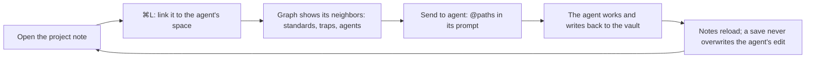

# Herdsidian

**Your Obsidian vault is your agents' memory. Herdsidian puts it next to them.**

A [Herdr](https://herdr.dev) layout for people who run their coding agents from an
Obsidian vault: agent briefs, standards, project notes and daily logs in Markdown, read by
the agents and written back by them. Herdsidian opens that vault in a **Notes** sidebar
beside your terminals. You read and edit notes while the agents work, link the right notes
to each space, and hand them to an agent with one click.


## Who it's for

- Your agent setup lives in a vault: `CLAUDE.md`-style briefs, agent definitions,
  standards, one note per project, a daily log the agents append to.
- You take notes all day, while the agents work, and want them one key away, not one
  app away.
- You want the agent to start from the right notes, and the notes to keep up with what the
  agents learn.

## The loop



1. **Open the note.** Browse the vault or find a note by name. `[[Wikilinks]]` (with
   `|alias` and `#heading`) open the linked note.
2. **Link it to the space.** `⌘L` links the open note to the focused agent's space.
   Linked notes stay in a strip, per space, across restarts. A note's pin switches it
   between "Whole space" and "This agent only".
3. **See what it touches.** The local graph shows the note's neighbors at 1 or 2 hops:
   the standards it cites, the traps it warns about, the agents that use it.
4. **Send it.** **Send to agent** pastes the linked paths into the agent's prompt:
   `@path` for Claude Code, the plain path for other agents. It never presses Enter.
5. **Let it write back.** When an agent (or Obsidian, or git) changes a note you have
   open, your save asks first: Reload or Overwrite.


**Link notes to a folder once, in the note itself.** A `herdsidian:` key in the
frontmatter links the note whenever an agent works in that folder or below it:

```yaml
---
herdsidian: ~/code/acme-api
---
# Acme API
```

## Features

- **Notes sidebar.** Folders, notes and search on the right. Read mode renders
  frontmatter, headings and links; `⌘E` switches to Edit and `⌘S` saves. Collapses to an
  icon rail. Any folder of Markdown files works; Obsidian is not needed.
- **Agent context.** Notes linked per space, with extras for one agent. Suggestions (the
  space's repo name, recent notes, alias or tag matches) show faded; one click pins them.
- **Local graph.** The open note (or the first linked note) at 1 or 2 hops, up to 40
  nodes. Drag to pan, scroll to zoom, click to open. Hide it if you don't need it.
- **Shortcut guide.** Each space shows `⌃1…⌃9` and each agent `⌘⌥1…⌘⌥9`, so you
  jump between agents without the mouse.
- **Graphite glass look.** Tinted glass over a gradient of the theme, terminals as solid
  cards. Eight themes, every color derived from the theme:
  `hs_carbon` (default), `hs_midnight` (Tokyo Night), `hs_catppuccin` (Mocha),
  `hs_nord`, and a light version of each.


## Install

<!-- TODO(publish): set <REPO_URL> and add the herdr.dev/layouts/<owner>/herdsidian line once the GitHub repo exists. -->
Clone it, then ask your agent from a Herdr terminal:

```sh
git clone <REPO_URL> herdsidian
```

> Read ~/.config/herdr-app/AGENTS.md, then add the Herdr layout in ./herdsidian.

Then press `⌘⇧O` and **Choose a vault**.

<details>
<summary>By hand</summary>

1. Copy `layouts/herdsidian.json`, the eight files in `themes/` and the seven folders in
   `mods/` into `~/.config/herdr-app/` (same paths). If you installed an earlier
   version, remove the old `themes/herdsidian_*.json` files.
2. Merge the `layout:herdsidian` and `mod:herdsidian` sections of `keys.json` into
   `~/.config/herdr-app/keys.json`.
3. Check the mods:
   ```sh
   cd ~/.config/herdr-app/mods
   for m in herdsidian herdsidian-chrome guide-spaces guide-agents herdsidian-tabs herdsidian-pane herdsidian-status; do herdr-app check $m; done
   ```
4. Switch to it: `herdr-app do layout.switch '{"name":"herdsidian"}'`, or Settings →
   Look, or Herdr's default `⌃⇧L`, which cycles layouts.

</details>

<details>
<summary>Only the Notes sidebar, in your own layout</summary>

Copy `mods/herdsidian/` and add this block as the last child of your layout's root row.
Herdr's own layouts are read-only, so clone one first:
`herdr-app do layout.clone '{"name":"main","as":"my-layout"}'`.

```json
{ "id": "herdsidian", "type": "block", "hidden": true, "size": { "px": 380 },
  "min": 44, "max": 720, "content": { "mod": "herdsidian" } }
```

Then bind a key in `keys.json`, for example
`"layout:my-layout": { "cmd-shift-o": "layout.toggle:herdsidian" }`, and add the
`mod:herdsidian` section.

</details>

## Keys

| Keys | What it does |
|---|---|
| `⌘⇧O` | Show or hide the Notes sidebar |
| `⌘L` | Link the open note to the focused agent's space (no note open: open the picker) |
| `⌘K` | Open the search picker |
| `⌘E` / `⌘S` | In a note: switch Read and Edit / save |
| `⌃1` … `⌃9` | Go to space 1–9 |
| `⌘⌥[` / `⌘⌥]` | Previous / next space |
| `⌘⌥1` … `⌘⌥9` | Go to agent 1–9 |
| `⌘[` / `⌘]` | Previous / next agent |

`⌘E` and `⌘S` live in the `mod:herdsidian` section and work only while the Notes panel
has the keyboard. The rest live in `layout:herdsidian`, so your keys in other layouts
don't change.

## What it isn't

- **Not an Obsidian replacement.** No tags view, no whole-vault graph, no image embeds
  (`![[image.png]]` shows its file name). Rename, delete and new folders stay in Obsidian.
- **Not a sync tool.** It reads and writes the files in place. Obsidian, git and your
  agents see the same files.
- **Not online.** Nothing reaches the network.

## What it runs and stores

- `herdsidian` reads and writes only inside the vault you choose. It runs `find` and `sh`
  to list notes, `awk` to read their links, `git` to find an agent's repo folder, and
  `open` (macOS) or `xdg-open` (Linux) for web links.
- Context links live in `${XDG_STATE_HOME:-~/.local/state}/herdsidian/context.json`:
  machine-local, never in the vault. A file written by a newer Herdsidian is shown and
  never overwritten.
- **Send to agent** puts the paths on the clipboard and pastes them only after the focus
  has reached the agent's terminal ("Pasted into <agent>. Review and press Enter.");
  otherwise it only copies and says "Copied. Press ⌘V in the agent." It never presses
  Enter. At most 600 characters, the center note first;
  "+N not sent" counts the rest. The button shows "Sending…" while a send runs. It is off
  for remote spaces.
- `guide-spaces`, `guide-agents`, `herdsidian-chrome`, `herdsidian-tabs`, `herdsidian-pane`
  and `herdsidian-status` are restyled copies of Herdr's `spaces`, `agents`,
  `workspace-chrome`, `tabs`, `pane` and `workspace-status` (0.1.10), with the same
  behavior. `guide-spaces` runs `git` and `hc machine ls` like the original.

## Known gaps

- The context file is not reloaded live: a change from another Herdr window shows after
  you relink or reopen.
- The note list and search cover up to 5,000 notes.
- Built and tested on macOS (the keys use `⌘`). Linux should work but is untested.
  Windows is not supported.

[RECIPE.md](RECIPE.md) describes exactly what it does and how it is built.

<details>
<summary>Development</summary>

The pure logic runs under Node with no Herdr imports: `mods/herdsidian/notes.js`
(Markdown, wikilinks), `graph.js` (link index, neighborhood, layout) and `context.js`
(context links, suggestions, Send text). `io.js` and `graph-view.js` need Herdr.

```sh
npm test            # node --test, no dependencies
npm run lint        # syntax, JSON, themes, mod references, shared-file copies, no hard-coded colors or home paths
scripts/demo.sh     # a separate Herdr window with a demo vault and demo agents (stop: scripts/demo.sh stop)
```

The demo runs with its own HOME, Herdr home, state folder and herdr-core session, and it
checks that the core it talks to is its own before it starts any agent, so your spaces,
settings and vault stay out of it. The README images come from it.

Three files in `lib/` are canonical: `tokens.js` (theme colors with alpha), `ui.js` (top
sheen, program icons) and `layout.js` (the `find` tree helper). A mod folder installs on
its own, so each mod that uses one carries a byte-identical copy. After editing one, copy
it into every mod that has it; `npm run lint` fails if a copy differs.

```sh
cp lib/tokens.js mods/<mod>/tokens.js
cp lib/ui.js mods/<mod>/ui.js          # herdsidian-chrome, herdsidian-tabs, herdsidian-pane, guide-agents
cp lib/layout.js mods/<mod>/layout.js  # herdsidian, herdsidian-chrome, herdsidian-tabs, guide-agents, guide-spaces
```

Check mod changes in Herdr with `herdr-app check`. The "Needs you" chip (`foreground` on
`blockedSoft`, 1 px `blocked` border) passes 4.5:1 contrast in all eight themes.

</details>

## License

[MIT](LICENSE)
