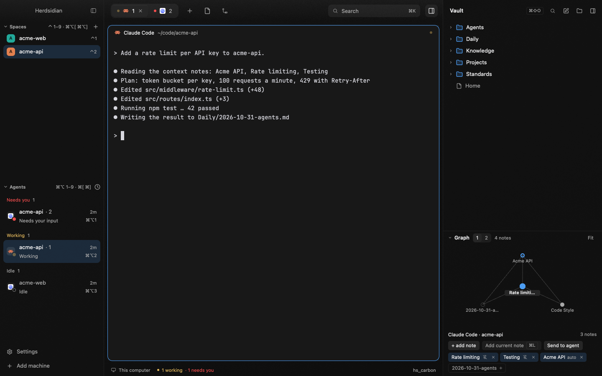

# Herdsidian

Herdsidian puts an Obsidian vault inside Herdr, in its own layout: the
Graphite Glass look. Sidebars and bars are tinted glass over a gradient of the
active theme, and panes are solid cards. Every color comes from the theme, so
each of the eight themes has its own tint. On the left, the spaces and agents
lists show the shortcut to each row. On the right, a Notes sidebar browses,
renders and edits the Markdown notes of an Obsidian vault.

## What you see

Left to right:

Root row: `titlebar: "none"`, macOS `traffic_lights` at [16, 19],
`terminal_padding` [14, 12].

1. **Sidebar**, 248 px (min 44, max 480, not resizable): a 52 px `brand`
   block (`herdsidian-chrome`, `window_drag`), `guide-spaces` and
   `guide-agents` stacked with equal weight (min 90 each), and an 80 px
   `sidebar-footer` block (`herdsidian-chrome` with `props: { footer: true }`).
   `herdsidian-chrome` is a clone of Herdr's `workspace-chrome`. The header has
   no brand: only the hide-sidebar button (28 px), right-aligned over a
   neutral top sheen. On macOS the header leaves 84 px on the left for the traffic
   lights. The footer has two 32 px rows, Settings and Add machine.
   - Spaces header: 24 px high, `Spaces` (11 px semibold `muted`) + the hint
     `⌃ 1–9 · ⌘⌥[ ⌘⌥]`, then a 22 px `+` button. Each of the first 9 rows
     ends with a plain `⌃N` in 11 px `muted` text.
   - Agents header: `Agents` + `⌘⌥ 1–9 · ⌘[ ⌘]`. Each of the first 9 agent
     rows shows `⌘⌥N` in 11 px `muted` text, under the status pill or the
     duration.
   - Rows: spaces 32 px (28 px for a worktree), radius 8. Agent rows have 7 px
     of vertical padding, radius 8 and a status line (11.5 px `muted`). The
     selected row is an `accent` pill at 18 %. Hover is `foreground` at 6 %.
     Space avatars 20 px, radius 6, with the letter in black at 75 %
     (`#000000bf`).
   - Agent icon tile: 20 px, radius 6, `foreground` at 6 % (10 % on the
     focused row), with the 13 px program icon centered (tinted SVGs in
     `foreground`, pictures as is). No icon: the first letter of the program
     name (11 px semibold `muted`). The status is an 8 px `statusDot` badge at
     the tile's bottom-right corner (a 12 px badge at right/bottom -4, so the dot's edge sits at -2) inside a 2 px ring of
     `chrome`; working pulses, idle is a ring. Sub-agent rows and the wide
     rail (60 px or more) use a 16 px tile with an 11 px icon and no badge
     (their status shows at the right).
   - No border between the lists or above the footer.
2. **Work column**:
   - `herdsidian-tabs` toolbar (52 px, `window_drag`, `canvas` at 35 %): a
     rounded track holding the tabs as a segmented control (28 px tabs, radius
     7, the active one `raised` with a 1 px top highlight), a new-tab button,
     Files and Changes buttons, a 220 px Search box with `⌘K`, the Notes
     toggle and the window buttons. The Search box opens the palette (item 4). Buttons are 30 px, radius 8. A 14 px
     program icon leads each tab name (`foreground` on the selected tab,
     `muted` otherwise for tinted SVGs; pictures as is). The top sheen fills the whole
     toolbar (180°, `foreground` 5 % at the top to transparent at the bottom
     edge). The tab track shrinks and scrolls when there are many tabs.
   - The active tab's panes as solid cards (radius 12, gap 8, padding 8,
     `lone: true`, background `background`, 1 px hairline border, 1 px
     `accent` border on focus). No shadow.
   - Pane header `herdsidian-pane`: 34 px, always shown. It has the agent
     name or terminal title (`foreground`, medium) after a 14 px program icon
     (`muted`), the folder (`muted`), a
     6 px status dot for working and done, a "Needs you" chip for blocked
     (`foreground` text on `blockedSoft` with a 1 px `blocked` border; the
     compact "!" chip in the agents list is the same),
     and split, zoom and close buttons on hover.
   - The hidden Files/Changes panel (368 px, min 280, max 900).
   - `herdsidian-status` bar (28 px, `canvas` at 35 %): machine, branch, the
     agent count or "N working" (and "· N needs you"), and the name of the
     active theme on the right. `⌘⇧P` still opens commands.
3. **Notes**, 380 px (min 44, max 720), hidden until `⌘⇧O`. Same glass as the
   sidebar.
   - Header 52 px: vault folder name (semibold), a `⌘⇧O` key cap, then 28 px
     icon buttons: search, new note, choose vault, collapse (`panel-right`).
   - No vault yet: the title is "Notes", the search button is hidden, and the
     body reads "Choose a folder of Markdown notes, or create an empty one to
     start. An Obsidian vault works too; Obsidian is not needed." above a
     `solid` "Choose a vault" button (`pickFolder`). The graph section is not
     shown until a vault is chosen.
   - Search box (when open): 30 px, radius 8, no border, `foreground` at 6 % fill.
   - Tree rows 28 px, radius 7, 16 px indent per level: chevron + a 16 px
     folder icon (`accent`, filled body), or a file icon and the note's name
     without `.md`. The selected note is an `accent` pill at 18 %, with an
     `accent` file icon.
   - Note view: back arrow, note name and its path (10.5 px `muted`); a bar
     with `Read` / `Edit` pills (22 px, radius 5), `⌘E` cap, a 7 px `working`
     dot when there are unsaved changes, `Save` and `⌘S` cap.
   - Rail (width under 160 px): expand, search and new-note icons in a column.
   - Graph section at the bottom: a header with a hide toggle, a `1 | 2` hops
     pill, "+N more" when nodes were cut, and a fit button. The body is the
     local graph of the open note (or the first context note): up to 40 nodes,
     edges and the center node. Hop-2 labels show
     on hover or at zoom 1.5 or more.
   - Agent context block: the focused agent's label, its linked notes (chips
     with unlink), faded suggestions (one click pins), "Add current note", a
     picker (`Find a note to link…`) and a Send button.
4. **The ⌘K palette**, a popup (`mod.json` `overlay`: `kind: "popup"`, `at: "top"`,
   `offset: 40`, `width: 680`, `frame: "none"`). It is the `herdsidian` mod started a
   second time with `props().overlay` set. The card is 680 px wide, radius 18, padding 16,
   the opaque theme `popover` color, a 1 px `line` border. Its height fits the content.
   - Header: a 14 px search icon and the search field (placeholder "Search notes, agents
     and commands…"), then the tabs All / Notes / Agents / Commands (24 px, radius 6;
     the active one `accentSoft` with `foreground` text, the others `muted`). With no
     vault there is no Notes tab.
   - Top hit (text typed, All tab): a 56 px row. The title is 14 px semibold
     `foreground`. A note's second line is 12 px `muted`:
     "<folders> · linked to <space> · edited <time>", with empty parts left out. An
     agent's is "<space> · <title>". The row ends with "Open ↵".
   - Sections Agents, Notes and Commands (title 11 px semibold `muted`), rows 32 px,
     radius 8, the selected one `accentSoft`. All shows at most 4 agents, 6 notes and
     4 commands (the Top hit is not repeated). A single tab shows up to 50, in a list
     that scrolls past 320 px.
   - Agent row: `statusDot`, the program icon (else its name), the space name, "— <title>"
     in `muted` (cut with an ellipsis), "needs you" in `blocked` for a blocked agent, and a
     `⌥⌘N` key cap when it is right (see How it behaves). Note row: the name and
     "— <top folder>". Command row: the label and its key cap.
   - Preview (`⇥`): under the list, the first 2,048 characters of the note, read-only,
     rendered as Markdown, 200 px high.
   - Footer: key caps "↵ Open" (Focus on an agent, Run on a command), "⌘↵ Send to
     agent", "⇥ Preview" and "esc Close". A key that does nothing for the selected row
     is `muted` at half opacity, with the reason as a tooltip.
   - Lines in `muted` 12 px: "Loading notes…", "No agents running", "No matches for
     "<text>"", and "Open Notes once (⌘⇧O) to choose a vault". Errors are `blocked`.

Look (layout root):
- Theme `hs_carbon` (default): background `#181818`, foreground
  `#d6d6dd`, selection `#2f3a4a`, accent `#4c9df3`, canvas `#0e0e0e`, chrome
  `#121212`, border `#2a2a2a`, ANSI red `#f14c4c`, green `#3fbf8f`, yellow
  `#e5b95c`, blue `#4c9df3`.
- Root `background`: `{ "gradient": ["chrome", "canvas"], "angle": 160 }`.
  The gradient uses theme color names, so it follows the theme: carbon is
  charcoal to black, nord is blue-grey, catppuccin is violet-black.
- The layout has no `colors` block. The glass is painted by the mods:
  sidebars and Notes use `chrome` at 55 %, the toolbar and status bar use
  `canvas` at 35 %.
- `terminal_opacity` 1. The pane background is the theme's `background`, so
  terminals read as solid cards on the glass.
- Pane border and root divider: `#ffffff12`. Pane focus: `accent`.
- `ui_font`: `.AppleSystemUIFont` (the macOS system font).

## How it behaves

- Agent statuses are Herdr's own (`guide-agents` is a clone of `agents`):
  working spinner, blocked "Needs you", done dot, idle ring (1.5 px, in the
  theme's `idle`).
- `⌘⌥N` focuses the N-th agent of the list as shown (pinned first, then the
  sort order). Numbers follow the whole list, so folding a group hides rows
  but keeps the numbering.
- `⌘K` opens the Herdsidian palette (`mod.open:herdsidian`), the same as the toolbar's
  Search box. `⌘K` again closes it. The shipped `picker` stays on the person's own key.
- The palette:
  - Target: the agent focused when the palette opened (`pickAgent`: the focused agent,
    else the remembered agent of the shown space). It is fixed at open. Moving over
    other rows does not change it.
  - Search: notes use `matchNotes` (the name contains the text, case ignored) and are
    ranked: name equals the text, starts with it, a word starts with it (after a
    space, `-`, `_` or `.`), contains it. Ties: notes linked to the target space,
    then the shorter name, then the path A to Z. Agents match on program, space or tab
    name (ranked the same way), then on title alone. Commands match on their label.
    No fuzzy matching.
  - Top hit: the best-ranked first row of any kind, only for a non-empty query on All.
    A note's "edited" time is one `stat` per top-hit path, run off render.
  - Empty query: no Top hit. All shows the agents, the target space's context notes
    (none if empty) and the commands. A single Notes tab lists the context notes, then
    the other notes A to Z.
  - Keys: `↑` `↓` move over the rows, across sections, wrapping. A click acts like `↵`.
    Hover does not select. `Esc` and a click outside close it. Herdr handles `Esc` and
    calls the copy's `close()` hook; nothing runs.
  - `↵` on a note: Notes is shown (`layout.show`) and opens it through its own `open()`,
    so a note with unsaved changes asks first. `↵` on an agent: `pane.focus` (else
    `agent.focus`). `↵` on a command: it runs, and the palette closes.
  - `⌘↵` on a note: it pastes that one path, with the same text rules as Send to agent
    (`deliveryText`: `@path` for Claude Code, the plain path for others, double quotes
    around spaces, one line). Order: the note must still exist (`stat`; else the toast
    "Note not found: <name>"), the text goes to the clipboard, `pane.focus` moves to the
    agent, 50 ms later it pastes only if `focused()` is that terminal, then the toast
    ("Pasted into <agent>. Review and press Enter." or "Copied. Press ⌘V in the
    agent."), then the palette closes. It never presses Enter. The clipboard keeps the
    path. A second `⌘↵` while one runs does nothing. It does nothing, and the footer
    says why, with no agent focused, a remote space, no vault or a row that is not a
    note (the `canSend` reasons).
  - `⇥` on a note toggles the preview. On other rows it does nothing.
  - Commands: "Link note to current agent…" (with a vault and a space), "New <agent> in
    <space>" (`tab.new` with the first installed `knownAgents()` entry, no task, no
    key), "Show Notes" / "Hide Notes" (`layout.toggle`), "Choose vault…" (only with no
    vault) and "All Herdr commands…" (`app.palette`, `⇧⌘P`). Only Herdsidian's own
    commands are listed. There is no "New agent" key: `⌘N` is Herdr's `space.new`.
  - Key hints come only from `keys()`: the `layout:<name>` section first, then
    `global`. A row with no real key shows none. An agent's `⌥⌘N` shows only when the
    layout has `guide-agents`, the agent's address is the Nth of `guide-agents.order`
    (N up to 9), and `guide-agents.focus-N` is bound.
  - Link mode: the command turns the field into "Find a note to link to <space>…",
    with a "Link to <space>" chip and only the Notes tab. `↵` runs the same
    `saveContext` as `⌘L`, bumps `herdsidian.context-rev` so Notes reloads the file,
    toasts "Linked <note> to <space>." and closes.
  - No vault: no Notes tab, no Link command, "Choose vault…" is offered, agents and
    commands work, and the line "Open Notes once (⌘⇧O) to choose a vault" shows. The
    vault comes from `herdsidian.vault`, which Notes publishes, so Notes must have
    started once.
  - Loading: agents and commands show at once. Notes show "Loading notes…" until the
    `find` returns; a failed `find` shows its error in that section only.
- Notes:
  - Click a folder to fold or unfold it. Click a note to read it.
  - Search filters every note in the vault by name (up to 200 hits, with the
    folder beside each).
  - Read mode renders Markdown. Frontmatter shows as a `yaml` code block.
    `[[note]]`, `[[note|alias]]` and `[[note#heading]]` become links that
    open the note: same folder first, then a path ending in it, then any
    note with that name. `http(s)` and `mailto` links open with `open`
    (macOS) or `xdg-open`.
  - Edit mode: Markdown editor, soft wrap, no line numbers.
  - Save (`⌘S` or the button) writes only if the file still has the text it
    had when opened. If not: a red banner "Changed outside Herdr since you
    opened it." with Reload and Overwrite.
  - Leaving a note with unsaved changes (back, another note, a wikilink)
    asks Save / Discard / Cancel.
  - Changes on disk (Obsidian, git) refresh the tree; the open note takes
    the new text when it has no unsaved edits. Writes under `.obsidian`,
    `.git`, `.trash` and `node_modules` are ignored.
  - New note: `Untitled.md` (or `Untitled N.md`) at the vault root, opened
    in Edit.
  - Collapse: resizes the block to 44 px and remembers the width it had.
  - Graph: built from `[[wikilinks]]` (and note embeds) found by `awk`, with
    backlinks derived. The center is the open note, else the first context
    note. 1 or 2 hops, at most 40 nodes (hop 1 before hop 2, the more
    connected first); the rest shows as "+N more". Drag pans, the wheel zooms
    (0.5 to 2), a click on a node opens the note. Hide state and hops are kept
    in `localStorage` (`graph.hidden`, `graph.hops`).
  - Context: notes link to the space, with per-agent extras. `⌘L` links the
    open note, or opens the picker when no note is open. A note's frontmatter
    key `herdsidian: <path or list>` auto-links it when the agent's folder is
    that path or inside it (`~` is expanded). Suggestions (space or repo name,
    recent notes, alias or tag match; at most 6) are faded; one click pins.
  - Links live in `${XDG_STATE_HOME:-~/.local/state}/herdsidian/context.json`,
    machine-local and not in the vault (ADR-0002). Unknown keys in the file
    are kept on write.
  - Send to agent: pastes paths and never presses Enter. Claude Code gets
    `@path`, other agents the plain path; a path with spaces is in double
    quotes. At most 600 characters (the `@` and quotes count), center note
    first, then the agent's pins, the space's notes, then auto links. "+N not
    sent" counts what did not fit. The text stays on the clipboard. If the
    paste fails, it only copies and the notice says "press ⌘V". Disabled for
    remote spaces.

## Built from

- Files: `layouts/herdsidian.json` (its root `"preview"` is
  `layouts/herdsidian.svg`, the picture in Settings → Look: copy it too),
  `themes/hs_carbon.json` (the layout's
  `"theme"`: copy it too, or the theme doesn't resolve),
  `themes/hs_midnight.json` (Tokyo Night: background `#1a1b26`,
  foreground `#c0caf5`, accent `#7aa2f7`),
  `themes/hs_catppuccin.json` (Catppuccin Mocha: background `#1e1e2e`,
  foreground `#cdd6f4`, accent `#cba6f7`), `themes/hs_nord.json`
  (Nord: background `#2e3440`, foreground `#d8dee9`, accent `#88c0d0`) and
  their light versions `themes/hs_carbon_light.json` (VS Code Light Modern
  style: background `#ffffff`, foreground `#3b3b3b`, accent `#005fb8`),
  `themes/hs_midnight_light.json` (Tokyo Night Day: background `#e1e2e7`,
  foreground `#3760bf`, accent `#2563d0`, muted `#47569a`; `ring` and `solid`
  stay `#2e7de9`),
  `themes/hs_catppuccin_light.json` (Catppuccin Latte: background `#eff1f5`,
  foreground `#4c4f69`, accent `#8839ef`) and `themes/hs_nord_light.json`
  (Nord Snow Storm: background `#eceff4`, foreground `#2e3440`, accent
  `#5e81ac`) as alternatives in Settings → Look, the seven mods, `lib/tokens.js`, and
  `keys.json` to merge into the person's.
- Themes: Nord's `chrome`, `muted` and `blocked` were adjusted so text and
  dots pass contrast on the glass. `idle` is lighter in the four dark themes so
  the idle ring reads on the selected row. The ANSI colors are untouched.
- Light themes: `working`, `blocked` and `done` use the darker shades of each
  palette so the dots read on a light background (3:1 on `chrome`). Latte has
  no dark enough yellow or green: `working` is its yellow darkened to
  `#b8740f` and `done` is its teal `#179299`. Tokyo Night Day `blocked` is its
  `red1` `#c64343`. Nord has no official light
  variant: `hs_nord_light` reverses the palette (Snow Storm background, Polar
  Night text) and darkens the Aurora green and yellow and the Frost cyan in
  its ANSI colors so terminal text stays readable.
- Layout: a clone of Herdr's `main` with the root look above, `spaces` →
  `guide-spaces`, `agents` → `guide-agents`, `tabs` → `herdsidian-tabs`, the
  pane header → `herdsidian-pane`, `workspace-status` → `herdsidian-status`,
  and a last root child
  `{ "id": "herdsidian", "type": "block", "hidden": true, "size": { "px": 380 },
  "min": 44, "max": 720, "content": { "mod": "herdsidian" } }`.
- The seven mods:

  | Mod | Role |
  |---|---|
  | `herdsidian` | The Notes sidebar. |
  | `herdsidian-chrome` | Sidebar header (hide button over the top sheen) and footer. Clone of `workspace-chrome`. |
  | `guide-spaces` | Spaces list with `⌃N` hints. Clone of `spaces`. |
  | `guide-agents` | Agents list with `⌘⌥N` hints. Clone of `agents`. |
  | `herdsidian-tabs` | The toolbar. Clone of `tabs`. |
  | `herdsidian-pane` | The pane header. Clone of `pane`. |
  | `herdsidian-status` | The status bar. Clone of `workspace-status`. |

- `guide-agents` stores the shown list in `this.order` and reads
  `nextCommand()` for `focus-N`. After each order change it publishes the first 9
  addresses as `guide-agents.order`, for the palette's `⌥⌘N` hints.
- `herdsidian`: `main.js` (the View), `notes.js` (pure helpers: `render`,
  `resolve`, `linkTarget`, `hidden`, `base`, `HIDDEN`, tested by `tests/notes.test.js`),
  and four new files:
  - `graph.js` (pure): the `awk` program and its output parser, `buildIndex`,
    `updateIndex`, `neighborhood` (cap `MAX_NODES` = 40), `layout`,
    `toScreen`, `zoomAt` (`ZOOM` 0.5 to 2), `sectionMessage`, `missingRaw`,
    `placeLabels`, `fitLabel`, `estimateWidth`, `LABEL`. Labels are placed by
    priority, hidden when they would overlap, and cut at 90 px with an
    ellipsis. Tested by
    `tests/graph.test.js`.
  - `context.js` (pure): `parseContext`, `serializeContext`, `change`,
    `findEntry`, `autoLinks`, `contextNotes`, `suggest`, `deliveryText`
    (`MAX_SEND_CHARS` = 600), `sendOrder`, `emptyDoc`, `pickAgent`, `canSend`. Tested by
    `tests/context.test.js`.
  - `io.js`: the Herdr side of both. `stateDir`, `loadContext`, `saveContext`
    (retries on a stale snapshot), `indexNotes` (one `awk` call per chunk of
    1,000 files), `allNotes` (one `find`, `MAX_NOTES` = 5000), `noteTime` (`stat -f %m`
    through `exec`) and `gitTop` (`git rev-parse --show-toplevel`).
  - `graph-view.js`: the Graph section and the Agent context block.
  - The palette, five files:
    - `palette.js` (pure): `tier`, `rankNotes`, `rankAgents`, `rankCommands`,
      `formatChord`, `keyHint`, `agentHint`, `commandList`, `scene`, `buildList`,
      `relativeTime`, `breadcrumb`, `topMeta`, `sendState`, `footer`, `visibleWindow`,
      `autoFromIndex`, `autoMeta`, `isFreshRequest`. Limits: 4 agents, 6 notes, 4
      commands, 50 in a single tab. Tested by `tests/palette.test.js`.
    - `send.js` (pure): the one paste sequence of Send to agent, used by Notes and the
      palette. `sendText`, `sendToasts`, `PASTE_WAIT_MS` = 50. Tested by
      `tests/send.test.js`.
    - `palette-main.js`: the `Palette` controller (state, keys, actions). Notes
      creates it in `init` when `props().overlay` is set.
    - `palette-view.js`: `paletteCard`, the card as a function of a plain model.
    - Tests for the Herdr-side additions are in `tests/io.test.js` (`allNotes`,
      `noteTime`) and `tests/lint.test.js` (the new rules).
  From `herdr`: `exec` (`sh` to list a folder and to read `XDG_STATE_HOME`,
  `find` for every note, `awk`, `git`, `open` for web links), `readTextFile`,
  `writeTextFile(path, text, expected)` for conflict-safe saves,
  `watchFolder`, `pickFolder`, `localStorage` (`vault`, `width`,
  `graph.hidden`, `graph.hops`, `recent:<vault>`), `nextCommand`,
  `run("layout.resize")`, `run("pane.focus")`, `run("terminal.paste")`,
  `agents()`, `layout()`, `notify`, and `cx.write_to_clipboard`. The palette also uses
  `keys()`, `spaces()`, `panes()`, `knownAgents()`, `props()`, `closeOverlay`,
  `run("layout.show")`, `run("tab.new")` and `shared` / `setShared`. From `gpui-base`: `TextView.markdown(...).on_link_click`,
  `EditorState` + `Editor`, `InputState` + `Input`.
- `lib/tokens.js`: the one place where theme colors get their alpha.
  `alpha(color, a)` takes `#rrggbb` or `#rrggbbaa` and returns a full
  `#rrggbbaa` color. `tokens(theme())` returns these full colors:
  `glass` (`chrome` 55 %), `mainGlass` (`canvas` 35 %), `line` (`foreground`
  7 %), `pill` (`foreground` 6 %, also hover), `accentSoft` (`accent` 18 %),
  `glow` (`foreground` 5 %, the top sheen), `glowEnd` (`foreground` 0 %), `blockedSoft` (`blocked`
  15 %), `node` (`muted`), `nodeFar` (`muted` 80 %), `edge` (`foreground`
  22 %, decorative) and `edgeHot` (`foreground`). Constants: `HIGHLIGHT` (`#ffffff0d`), `PULSE` and `GLOW_ANGLE`
  (180). `HAIRLINE`, `tokens().workingLine` and `tokens().highlight` were
  removed (nothing used them; mods import `HIGHLIGHT` directly).
  `statusDot(theme, status)` gives the dot recipe (fill or ring, pulse).
  Tests: `tests/tokens.test.js`.
- `lib/ui.js`: `icon(p, size, color)`, a program's icon (a tinted SVG in
  `color`, else the picture as is; null without one), used by `guide-agents`,
  `herdsidian-tabs` and `herdsidian-pane`. And `glow(k)`, the top sheen shared
  by `herdsidian-chrome` and `herdsidian-tabs`. It paints the full size of its block with
  `GLOW_ANGLE` from `k.glow` (top) to `k.glowEnd` (bottom edge, fully
  transparent). Both blocks are 52 px high, so the halves meet at the
  divider. It uses the global gpui `window`, not herdr's `window` import.
  It imports `gpui-kit`, so Node tests do not import it.
- `lib/layout.js`: `find(node, id)`, a pure tree search used by `herdsidian`,
  `herdsidian-chrome`, `herdsidian-tabs`, `guide-agents` and `guide-spaces`.
- Copy rule: `lib/tokens.js`, `lib/ui.js` and `lib/layout.js` are the
  canonical files. Each mod that uses one carries a byte-identical
  `mods/<mod>/<name>.js`, because a mod folder is installed on its own. After
  you edit a canonical file, copy it into every mod that has it
  (`cp lib/tokens.js mods/<mod>/tokens.js`; `ui.js` lives in
  `herdsidian-chrome`, `herdsidian-tabs`, `herdsidian-pane` and `guide-agents`). `npm run lint` fails if a copy
  differs.
- Icons: Herdr's `mods/workspace-chrome/*.svg` and `mods/files/*.svg`, plus
  the SVGs inside `herdsidian`, `herdsidian-tabs` and `herdsidian-pane`.
- Keys: `layout:herdsidian` (`cmd-shift-o` → `layout.toggle:herdsidian`,
  `cmd-k` → `mod.open:herdsidian`, `cmd-alt-1..9` → `guide-agents.focus-N`,
  `ctrl-1..9` → `space.select:N`, `cmd-alt-[`/`]` → `space.prev`/`next`,
  `cmd-[`/`]` → `agent.prev`/`next`, `cmd-l` → `herdsidian.link`, so every
  shortcut the sidebar shows works) and `mod:herdsidian` (`cmd-s` →
  `herdsidian.save`, `cmd-e` → `herdsidian.mode`). Inside the palette, `⌘↵` and `⇥`
  are not in `keys.json`: the search field's `submit` event (with `secondary` set for
  `⌘↵`) and the key handler read them.
- Shared keys of the palette (`shared()` / `setShared()`). Each is written only when its
  value changes. The 5,000-note list never goes through `shared()`.

  | Key | Written by | Holds |
  |---|---|---|
  | `herdsidian.vault` | Notes (`init`, choose vault) | The vault path. |
  | `herdsidian.auto` | Notes (after an index build) | `{ vault, notes }`: notes with a non-empty `herdsidian:` list, at most 200. |
  | `herdsidian.memory` | Notes (`focus`) | The remembered agent per space, for `pickAgent`. |
  | `herdsidian.request` | Palette | `{ id, at, op, path?, vault }`: open a note or choose a vault. Notes handles an `id` once, and a request younger than 5 s at start. |
  | `herdsidian.context-rev` | Palette (after link) | A number. Notes reloads the context file when it changes. |
  | `guide-agents.order` | `guide-agents` | The first 9 agent addresses, in list order. |

- The overlay: `mods/herdsidian/mod.json` has the `overlay` block, and `keys.json` binds
  `cmd-k` to `mod.open:herdsidian` in `layout:herdsidian`. `herdsidian-tabs` runs
  `mod.open {name: "herdsidian"}` from its Search box. `npm run lint` checks that every
  `mod.open:<name>` in `keys.json` names a mod in `mods/` or one shipped with Herdr
  (`picker` is on that list).

## Watch out

- `TextView` is exported by `gpui-base`, not `gpui-kit`.
- Theme files want `#rrggbb` (no alpha). Layout colors such as the pane
  border and the divider accept `#rrggbbaa`. The glass comes from the mods,
  which add alpha with `lib/tokens.js`.
- A theme name in the JSON cannot carry alpha. Use a name alone (`"accent"`,
  `"background"`, or in a gradient `["chrome", "canvas"]`) or a full hex.
  For a transparent theme color, add the alpha in the mod with `alpha()`.
- Gradient stops accept theme color names: the root `background` uses
  `["chrome", "canvas"]` at angle 160, and it follows the active theme.
- There is no blur API, so the glass is transparency only (a color with alpha
  over the gradient).
- `shadow` on the pane frame shows nothing, so the cards have no shadow.
- `bg()` takes a plain color, not a gradient. The top sheen is painted with
  `window.paint_path(..., Background.linear_gradient(...))`, in
  `herdsidian-chrome` (sidebar header) and `herdsidian-tabs` (toolbar), both
  through `glow()` in `lib/ui.js`. It runs at 180° over the full block and ends
  fully transparent at the bottom edge (at 160° a faint band was left there).
  Use the gpui global `window`, never herdr's `window` import.
- `ui_font` is `.AppleSystemUIFont`. It loads with no error. Its visual
  effect on the UI text is still to be confirmed.
- `dim` is never used as text color (it fails contrast on the glass). Text
  uses `muted` or `foreground`. `dim` is only a dot or an icon color.
- `herdsidian-tabs`, `herdsidian-pane` and `herdsidian-status` are frozen
  copies of Herdr's `tabs`, `pane` and `workspace-status` at version 0.1.10
  (`cloned_from` in each `mod.json`). Fixes in newer Herdr versions do not
  reach them: when Herdr updates, diff each clone with the shipped mod.
- Never hard-code a color in a mod. `npm run lint` rejects any hex literal
  (3, 4, 6 or 8 digits) in `mods/**/*.js`, and alpha glued to a string
  (`+ "26"`, `` `${c}2e` ``). The only exception is the six space avatar
  colors and the avatar letter (`#000000bf`), and only in
  `mods/guide-spaces/main.js`. The `tokens.js`, `ui.js` and `layout.js`
  copies must equal `lib/`, and mods named by the layout and keys must exist
  in `mods/` or ship with Herdr (`workspace-chrome`, `files`, `changes`).
- The sidebar toggle writes `sidebar.collapsed` as well as the width: Herdr's
  own `agents` and `workspace-chrome` mods still read that flag. Both
  `herdsidian-chrome` and `guide-agents` restore to 248 px.
- `watchFolder` reports `.obsidian/workspace.json` writes all the time:
  filter them, or the open note reloads and the editor loses its cursor.
- Never reopen the note after your own save; compare with the saved text.
- Callbacks run later (after Save/Discard) must take their own `cx`.
- `writeTextFile` rejects for any failure; re-read the file to tell a stale
  snapshot (conflict) from another error.
- `<mod>.<command>` keys reach shown copies only: `⌘S`/`⌘E` do nothing while
  Notes is hidden.
- `⌘L` (`herdsidian.link`) is a `<mod>.<command>` key too: it works only
  while Notes is shown.
- Herdr cannot type into a terminal without pressing Enter, so Send pastes
  (`pane.focus` then `terminal.paste`). Notes never calls `terminal.send` or
  `keys`; `npm run lint` rejects them in `mods/herdsidian`.
- Claude Code collapses a paste of about 1,200 characters into
  `[Pasted text]`. Send stops at 600 to stay well under it.
- The paths stay on the clipboard after Send, by design.
- Wikilinks split across two lines are not indexed (`awk` reads line by
  line).
- Use `globalThis.window.paint_path` for the graph. Herdr's `window` import
  shadows the gpui global; `npm run lint` rejects a bare `window.paint_path`.
- No per-frame animation. The layout is computed once, in `cx.spawn` (off
  the render path), and render only reads the result. Never start work from
  `render`.
- The context file is not live-reloaded: a link made in another Herdr window
  shows only after this one reloads it.
- Graph marks reach at least 3:1 and muted labels at least 4.5:1 in all
  eight themes (the `edge` line is decorative).
- `⌘L` with no note open opens the picker without moving the keyboard focus;
  a click focuses it. Send pastes only after the focus has reached the
  agent's terminal (it waits 50 ms after `pane.focus`), otherwise it only
  copies. A context file from a newer Herdsidian is shown in the strip and
  never overwritten.
- The palette is a second copy of the `herdsidian` mod, so:
  - `localStorage` is not shared between the Notes copy and the popup copy. The popup
    reads the vault from `shared("herdsidian.vault")`, so Notes must have started once
    (shown with `⌘⇧O`) before the palette knows the vault, the auto links and the
    agent memory.
  - Module-level state is per copy. Do not keep palette state in a module variable.
  - `herdsidian.<command>` keys (`link`, `save`, `mode`) reach shown copies only. The
    popup copy gets them while it is open; a hidden Notes does not.
  - Esc is handled by Herdr, not by the mod. No key event arrives. The `close()` hook
    runs on every close, so cleanup goes there.
  - A synthetic osascript click is not delivered to GPUI. Test a click outside the
    palette with a real click.
  - `fs/promises` is not available. Read a file's time with `stat -f %m` through `exec`
    (`noteTime`, about 12 ms).
  - One `find` over 5,000 notes takes about 30 ms. The palette runs it once per open, in
    `cx.spawn`, never in `render`, and never builds the link index.
  - A Send from the palette must finish its paste before the copy ends: it pastes, then
    closes. A closed overlay ends its async work.
  - The palette files are under the no-submit lint rule like the rest of
    `mods/herdsidian`. `⌘↵` is read as `submit` with `secondary`, never as the string
    `"enter"`.
  - `palette.js`, `send.js`, `notes.js`, `context.js` and `graph.js` must not import
    `herdr`, `gpui-kit` or `gpui-base`. `npm run lint` reports the file and line.
- Herdr runs a single window (`window()` has no id and there is no new-window command), and `shared()` is app-wide, so palette requests are not scoped to a window. Revisit this if Herdr adds multi-window support.
- The shipped `picker` is not removed. It stays reachable through the person's own
  `cmd-p` binding; only `layout:herdsidian`'s `cmd-k` changed.
- Clicks in Settings → Look are saved in `layouts/.state/` and win over the
  layout file. If `terminal_opacity` or the pane look is not what the file
  says, check `herdr-app status` and re-save the layout file.

## Done when

- The eight `themes/hs_*.json` are in `~/.config/herdr-app/themes/`
  and show in Settings → Look.
- `herdr-app check` passes for all seven mods: `herdsidian`,
  `herdsidian-chrome`, `guide-spaces`, `guide-agents`, `herdsidian-tabs`,
  `herdsidian-pane` and `herdsidian-status`.
- `layout.switch herdsidian` shows the glass look, hints on spaces and
  agents, and no errors in `herdr-app status`.
- Each theme gives the glass its own tint (`app.theme` with each name).
- `⌘⇧O` shows Notes; a first run offers Choose a vault. `⌘K` opens the Herdsidian palette.
- `⌘K` opens a popup 40 px from the top, 680 px wide, and the search field has the
  keyboard at once. `⌘K` again, `Esc` or a click outside closes it, and typing then
  lands in the terminal that had the keyboard.
- The palette shows All / Notes / Agents / Commands. `↵` opens a note, focuses an agent
  or runs a command. `⇥` previews a note. With no vault it says "Open Notes once
  (⌘⇧O) to choose a vault".
- `⌘↵` on a note pastes its path into the agent that was focused at open, never
  presses Enter, and leaves the agent `idle`. With no agent it does nothing and the
  footer says why.
- A `⌥⌘N` hint on an agent row matches the key in the agents list.
- A note opened from the palette while a note has unsaved changes asks Save / Discard /
  Cancel first.
- A note opens in Read, a `[[wikilink]]` opens its target, `⌘E` edits,
  `⌘S` saves to disk.
- Editing the file from a shell while it has unsaved edits, then `⌘S`,
  shows the conflict banner and leaves the file untouched.
- Collapse makes a 44 px rail; expand brings back the previous width.
- The Graph shows the open note's links at 1 and 2 hops (40 nodes at most),
  pans, zooms and opens a note on click; hide and hops survive a restart.
- `⌘L` links the open note; `context.json` appears under
  `${XDG_STATE_HOME:-~/.local/state}/herdsidian/`, not in the vault.
- Send pastes `@path` into Claude Code (plain path for others), never
  presses Enter, and leaves the paths on the clipboard.
- `npm test` passes (307 tests: `graph.test.js`, `context.test.js`, `palette.test.js`,
  `send.test.js` and the rest; the 5,000-note index builds in about 70 ms) and
  `npm run lint` exits 0.
- `herdr-app status` shows no errors after the install, and one overlay while the
  palette is open, none after it closes.
